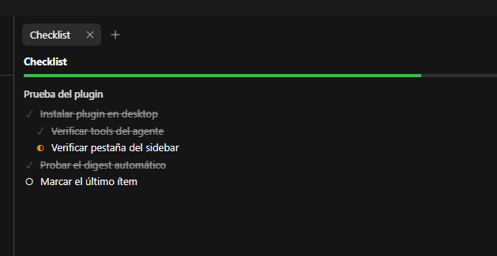

# dsh-checklists

Session-scoped checklists for **DeepSeek Harness**. The agent owns the list, the
model always sees it, and a read-only sidebar tab mirrors it.

The problem this solves is not "having a list". It is having to **dictate the list
again** every session. Here the checklist is created once, injected into the model
context on every turn, and updated as work progresses — no reminders needed.

## How it works

1. The agent creates a checklist (`checklist_create`), optionally from a template.
2. A compact digest of every checklist is injected into the prompt on each
   assembly, so the model always knows what is pending.
3. The agent marks items as it finishes them (`checklist_check`).
4. The sidebar tab shows the same tree, read-only, updated every two seconds.

If the agent forgets to mark something, you say so in chat and it fixes it.

## Tools

| Tool | What it does |
|---|---|
| `checklist_create` | Creates a list, from scratch or from a template (`release`, `feature`, `debug`, `review`) |
| `checklist_add` | Appends items to an existing list, optionally under a given item |
| `checklist_check` | Sets one or more items to `todo` · `doing` · `done` · `blocked` |
| `checklist_next` | Returns the next actionable leaf, its path, and how many remain |
| `checklist_edit` | Changes an item's text (not its state) |
| `checklist_list` | Full tree with ids and states, for when the digest is truncated |
| `checklist_delete` | Deletes a list (by id or exact title) |
| `checklist_remove_item` | Removes one item and everything nested under it |
| `checklist_rename` | Renames a list; titles stay unique within the session |
| `checklist_template_save` | Saves a list as a reusable template for future sessions |

Items are plain strings. **Two leading spaces per level** nest them:

```json
["Deploy to staging", "  Smoke tests", "  Rollback plan"]
```

## Install

```sh
dsh plugin --profile web add dsh-checklists
```

From a local build or tarball:

```sh
npm install
npm run build
npm pack
dsh plugin --profile dev add ./dsh-checklists-0.6.0.tgz
dsh --profile dev --dump-config        # the tool-checklist row should appear
```

Install into a test profile first. `web` and `headless` are distinct profiles, and
so is the desktop app's `desktop` profile.

## Configuration

Override the defaults on the plugin's entry in the profile's `cordis.patch.yml`:

```yaml
- id: tool-checklist
  name: dsh-checklists
  config:
    maxDigestLines: 12      # lines of the injected digest
    maxItemsPerList: 200    # per-list item cap
    pruneDays: 14           # prune untouched sessions after N days (0 = never)
    nudge: steer            # steer | observe | off — see "Turn-end gate"
    # storageRoot: "D:/data/dsh-checklists"
    # templates:
    #   my-flow: ["Step 1", "  Sub-step", "Step 2"]
```

## Data

```
$DSH_HOME/storages/dsh-checklist/
├─ sessions/<sessionId>.json    one document per session
└─ templates.json               templates shared across sessions
```

Writes are atomic (temp file + rename) and serialized per session. A corrupt
document degrades to an empty list instead of failing the turn.

> The package is `dsh-checklists`, but its storage directory keeps the
> `dsh-checklist` prefix. That path is data, not identity: renaming it would orphan
> every checklist already saved.

## Sidebar tab



Open the right sidebar, then the **guide** (`+`) and pick **Checklist**.

| Action | How |
|---|---|
| Collapse | Click a list title, or the `▾` on any item with children |
| Auto-collapse | When a **new** list appears, the others fold and the new one opens |
| Hide completed | The "Hide done" button, shown only when something is done |
| Copy as markdown | "Copy" — paste into a PR or an issue |
| Edit an item's text | **Double-click** the text; Enter saves, Esc cancels |

Item **states** remain agent-only: the tab cannot check anything off. The one write
path is text editing, through `POST /dsh-checklist/item` with `expectedText`. If the
item changed since the tab read it, the host answers **409** rather than overwriting
the agent's edit.

## HTTP routes

| Route | Method | Purpose |
|---|---|---|
| `/dsh-checklist/state` | GET | One session's state (read-only, `no-store`) |
| `/dsh-checklist/item` | POST | Edit an item's text, with a conflict guard |
| `/dsh-checklist/nudge` | GET | Recent turn-end gate decisions |
| `/dsh-checklist/client-probe` | GET | Client load diagnostics |

## Turn-end gate

A checklist only helps while it is true. The gate closes the most common gap:
a turn does real work, forgets to mark it, and the list is stale by the time you
look at it.

When a turn is about to close, the plugin checks exactly three things:

1. Did the turn run a tool that changes the workspace (`bash`, `edit`, `write`, …)?
2. Did it skip every checklist write?
3. Is anything still marked `doing`?

If all three hold, the agent gets one short steering message before the turn ends:

> Before you finish: N checklist item(s) are still marked "doing". If you
> completed any of them this turn, update them with checklist_check and say what
> proves it. If not, leave them as they are — do not mark work you did not do.

It never guesses **what** was completed — only that the bookkeeping was skipped.
At most one nudge per turn, and none when the turn was pure conversation or the
checklist already changed.

Inspect recent decisions at `GET /dsh-checklist/nudge`:

```jsonc
{ "mode": "steer", "entries": [
  { "source": "turn-stopping", "nudge": true, "steered": true,
    "reason": "1 item(s) still doing after workspace changes", "doing": 1 }
] }
```

`nudge: observe` records without interrupting; `nudge: off` disables the gate.

## Language

The panel follows the harness locale: **Spanish** when `locale` starts with `es`,
**English** for everything else. If the locale service is unavailable, it falls back
to English instead of breaking.

Text addressed to the **model** — tool descriptions, rendered results, the digest —
is English and is not translated: it is prompt material, not interface copy.

## Design notes

- **One writer.** The agent writes state; the sidebar writes text. No optimistic
  state, no two-tab divergence.
- **Digest budget.** Each checklist gets an equal share of the line budget. Giving
  the first list the whole budget starved the rest: with two lists the second
  showed a single line, and a third never appeared.
- **Pending first.** Truncation never hides unfinished work.
- **Client plugins load through `window.__ModuleLoader__` and only `require('react')`.**
  No bundler needed, but a **static `inject` of a service that never resolves parks
  the plugin silently** — `apply` never runs and nothing appears. Tab types must be
  registered lazily (`ctx.inject([...])`).

## Verification

```sh
npm run typecheck
npm run test      # vitest
npm run smoke     # same checks, in-process, no child processes
```

`npm run smoke` exists because some sandboxes deny `spawn` with `EPERM`, and then
Vitest cannot start its workers. It covers the model, digest, store, public state
and both HTTP routes (23 checks) against the compiled `lib/`.

## Known limits

- No reordering and no drag-and-drop.
- No edit history (who marked what, when).
- Text only: there is no "add a checklist item from the panel" affordance.
- Document format is `version: 1`; any change must migrate.
- The tab polls every 2 s while mounted — deliberate, the route is read-only.

## License

MIT
